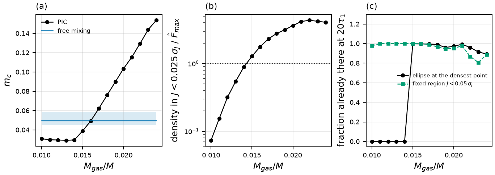
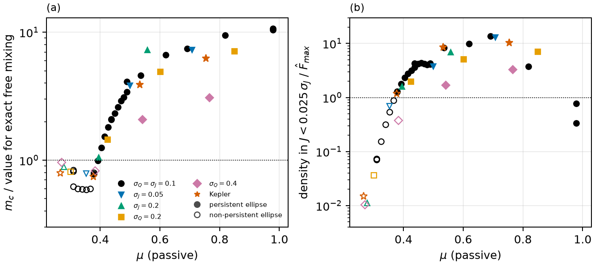
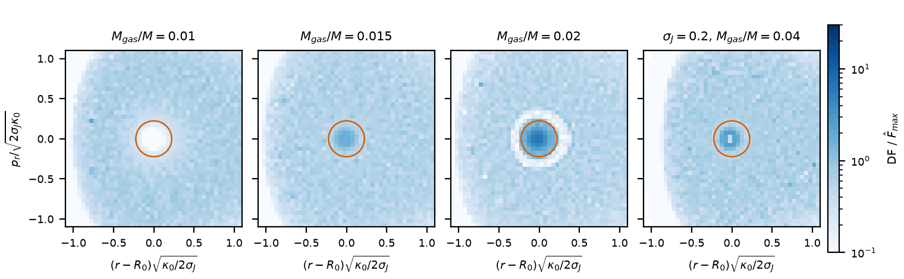
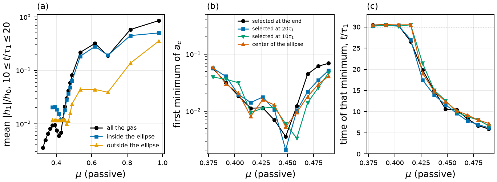

# What counts as a core: checks with the simulations

22 November 2026. Preparation for the rewriting of Section V. The manuscript was not changed.
Script: `reproducir/scripts/nucleo_criterio.py`. Numerical output: `exe/demo_eta/bulto/criterio/` (not versioned).

## Objective

Section V uses two signs of a core, which disagree near the change of regime: a peak of the angle-averaged DF above
F̂_max, and a mass m_c above the bound m_mix = 0.042. We ask five questions:

1. What value does the estimator of m_c return for a gas that is really mixed?
2. Is the peak found at M_gas/M = 0.015 a real object?
3. Does the central peak appear at a definite mass, or does it grow continuously?
4. Does the steep growth of |h₁| come from the core or from the gas around it?
5. Does the oscillation amplitude a_c depend on which particles are followed?

## Numerical setup

We analyze the stored snapshots of the 39 PIC runs of Section V, and nine new runs with M_gas/M = 0.011 to 0.019 in steps of
0.001. The new runs use the 400 × 100 lattice truncated to the particles with non-negligible weight, as the runs from 0.021 to
0.024. They differ from those runs only in the mass. Time is in the dimensionless units of the article, and τ₁ = 2π/ΔΩ. The
time means use t ≥ 20 τ₁, as in the article. We label the runs with the passive μ of `mu_conventions.md`.

We use three measurements of the late state:

- **Central density:** the mean angle-averaged DF in J < 0.025 σ_J, in units of F̂_max. F̂_max is the largest density of a gas
  mixed at fixed action, so a value above one requires a change of the actions.
- **m_c:** the fraction of the gas inside an ellipse of action J_* = 0.05 σ_J, centered at the densest point of the
  (r, p_r)-plane. As a reference we use the **exact free mixing** of the same lattice at the same times. Without self-gravity
  each row of the lattice rotates rigidly with Ω(J), so this state needs no simulation.
- **Persistence of the ellipse:** the fraction of the mass in the ellipse at the end of the run that was already in the ellipse
  at 20 τ₁. It tells whether the ellipse stays on the same gas or moves among fragments of the spiral.

## Main results

### The central density grows continuously

**Figure 1.** Runs on the 400 × 100 lattice. (a) m_c and its value for free mixing (the band goes from one standard deviation
below the mean to the 99th percentile). (b) Central density. The dotted line marks F̂_max. (c) Fraction of the gas already
present at 20 τ₁, for the ellipse at the densest point and for the fixed region J < 0.05 σ_J.

| M_gas/M | μ | Central density / F̂_max | m_c | Persistence of the ellipse |
| --- | --- | --- | --- | --- |
| 0.010 | 0.31 | 0.07 | 0.031 | 0.00 |
| 0.012 | 0.34 | 0.32 | 0.030 | 0.00 |
| 0.014 | 0.37 | 0.89 | 0.030 | 0.00 |
| 0.015 | 0.38 | 1.28 | 0.039 | 1.00 |
| 0.016 | 0.39 | 1.77 | 0.049 | 1.00 |
| 0.018 | 0.42 | 2.77 | 0.076 | 0.99 |
| 0.020 | 0.44 | 3.64 | 0.103 | 0.97 |

The value of m_c for free mixing on this lattice is 0.050.

Panel (b) is the main result. From 0.01 to 0.022 the central density rises smoothly by a factor 60, with no jump at the
resolved step of 0.001. It passes F̂_max at M_gas/M ≈ 0.0143 (μ ≈ 0.37, by linear interpolation). Between 0.021 and 0.025 it
stays between 4.1 and 4.4 F̂_max while m_c continues to grow. We have not determined whether this reflects a wider peak or
its growing oscillation, which also raises the action of its particles.

Panels (a) and (c) show an apparent onset, which **comes from the estimator**. Both m_c and the persistence use an ellipse placed
at the densest point. For M_gas/M ≤ 0.013 the densest point is a fragment of the spiral and the ellipse never contains gas
near J = 0. At 0.014 it sits on the central peak in 60 percent of the late snapshots and on the spiral in 31 percent. From
0.015 on it stays on the peak. The
change occurs where the central density reaches F̂_max, the density of the surrounding mixed gas. The persistence therefore jumps
from 0 to 1 between 0.014 and 0.015 although the gas near J = 0 changes smoothly.

In the fixed region J < 0.05 σ_J, the gas at the end was already there at 20 τ₁ for all masses. A slowly perturbed gas conserves
its action, so this result does not by itself identify a bound object.

### Comparison of the criteria

**Figure 2.** Horizontal axis: passive μ. (a) m_c divided by its value for exact free mixing. (b) Central density. Filled symbols
are runs whose ellipse is persistent (at least 0.4; no run lies between 0.12 and 0.47). M_gas/M = 0.3 (μ = 1.69) lies outside the
range.

Central density above F̂_max and a persistent ellipse agree in 44 of the 48 runs.

| Case | Runs |
| --- | --- |
| Density above F̂_max and persistent ellipse | 29 |
| Density below F̂_max and non-persistent ellipse | 15 |
| Density above F̂_max, non-persistent ellipse (25 columns, near the crossing) | 2 |
| Density below F̂_max, persistent ellipse (M_gas/M = 0.1) | 2 |

The first disagreement is a resolution effect. At M_gas/M = 0.015 the ellipse does not lock on the peak with 25 columns and does
with 100, while the central density is the same (1.27 and 1.28 F̂_max). The second is physical in origin. At M_gas/M = 0.1 the
object persists but has moved away from J = 0, so the density near J = 0 no longer measures it.

### The state near the crossing

**Figure 3.** Time-averaged DF in units of F̂_max near the circular orbit, for t ≥ 20 τ₁. The axes are rescaled so that orbits of
constant action are circles. The circle marks J = 0.05 σ_J. The first three panels use the 400 × 100 lattice and the last one
uses 25 columns.

At M_gas/M = 0.01 the region around the circular orbit is depleted. At 0.015 a small peak appears, inside the circle. At 0.02 the
peak is dense, fills the circle, and is surrounded by a depleted ring that we have not analyzed. The small hole at the center of
the last panel is probably a discretization effect. We tested this only at M_gas/M = 0.02, where the 400 × 25 run has a similar
dip and the runs with 400 × 100 and 3200 × 100 points do not.

### The core in physical space

Added 23 November 2026 (step `capa` of the script). In physical space the core is a thin spherical shell at r ≈ R₀. We measure the
largest instantaneous value of dM/dr, in a window of width a (the radial semi-axis of the ellipse), averaged over t ≥ 20 τ₁ and
divided by the same quantity for the exact free mixing of the same lattice.

- The condition "ratio above one" agrees with F̂_c > F̂_max in 44 of the 47 runs with self-gravity. The exceptions are M_gas/M = 0.015
  with N_Q = 100, at the crossing, and the two runs with M_gas/M = 0.1, where the shell is present (ratio ≈ 4.2) and F̂_c misses it.
- In each of the five other families, the two conditions change between the same pair of runs.
- When the ratio exceeds one, its maximum lies within about 3 percent of R₀, except at M_gas/M = 0.3 (0.89 R₀). In free mixing the maximum
  lies at 1.24 R₀.
- Near the crossing the ratio depends on the lattice: 0.98 and 0.86 at M_gas/M = 0.01 for N_Q = 25 and 100, and 1.02 and 0.95 at 0.015.
  It therefore describes the shell, but it does not locate the crossing better than F̂_c.

### The growth of |h₁| and the oscillation of the core

**Figure 4.** (a) Mean of |h₁|/h₀ over 10 ≤ t/τ₁ ≤ 20, for all the gas and, where the ellipse is on the peak, for the parts inside
and outside it. (b) First minimum of a_c for four ways of following the core: particles selected at the end, at 20 τ₁ or at
10 τ₁, and the center of the ellipse. (c) Time of that minimum. The dotted line marks 30 τ₁, close to the end of the runs. Panels
(b) and (c) start at M_gas/M = 0.015.

The total |h₁| is not monotonic. It rises from 2.4 × 10⁻³ at M_gas/M = 0.01 to 9.5 × 10⁻³ at 0.016, falls to 6.0 × 10⁻³ at 0.018,
and then grows steeply. Between 0.02 and 0.025 it grows by a factor 6.7. The part inside the core grows by 5.5 and the part outside
by 2.0, so this steep growth is mainly the coherent oscillation of the core. Below 0.02 the decomposition is not useful: the two
parts are larger than their sum and partly cancel.

Panel (c) shows that the time of the first minimum of a_c is robust, with differences of at most 4 τ₁ between methods. It grows as
the mass decreases, from 6–7 τ₁ at 0.025 to the end of the run at 0.017 and below. In those runs a_c is still decreasing at 30 τ₁,
so **the runs cannot tell whether the oscillation regrows later**. The depth of the minimum is not robust: it changes by a factor
1.3 to 3.6 between methods.

## Physical interpretation

**What the data show.** Between M_gas/M = 0.01 and 0.022 the density near the circular orbit grows continuously with the mass, and it
exceeds the largest density of a gas mixed at fixed action at M_gas/M ≈ 0.014. We find no threshold in this interval.

**What we interpret.** The "central accumulation" and the core are the same structure at different masses. Self-gravity changes the
actions of part of the gas and brings it near the circular orbit. The large values of |h₁| measure the oscillation of this structure.

**What remains to be checked.** We have no runs between M_gas/M = 0.001, where the central density equals that of the run without
self-gravity, and 0.01. We do not know whether the oscillation regrows after 30 τ₁ for M_gas/M ≤ 0.018. We have not traced the
particles of the peak back to see how they reach the circular orbit.

## Numerical validation

- Reanalyzing the 39 earlier runs together with the nine new ones reproduces exactly their m_c, free-mixing reference and central
  density.
- The nine new runs use the same executable and source as the runs from 0.021 to 0.024.
- The free-mixing reference reproduces the run without self-gravity (m_c = 0.051).
- The central density agrees between lattices at M_gas/M = 0.01 (0.073, 0.071 and 0.074 for 400 × 25, 800 × 25 and 400 × 100) and at
  0.015 (1.27 and 1.28 for 25 and 100 columns, with about 21 and 89 effective particles).
- At M_gas/M = 0.02 the central density with 25 columns is 17 percent above the value with 100 columns (4.27 and 3.64).
- The profile of the core at M_gas/M = 0.02 is the same with 400 × 100 and 3200 × 100 points.
- In the nine new runs the largest relative change of the total energy is 7.0 × 10⁻⁶, and all the gas remains bound.
- Not tested: N_Q > 100 near the change; the Kepler run with 0.02 on a finer lattice; times beyond the end of the runs.

## Conclusions

1. Between M_gas/M = 0.01 and 0.022 the central peak grows continuously. We find no onset mass in this interval.
2. The apparent onset in m_c and in the persistence comes from the ellipse, which moves to the central peak once this is the densest
   point. It should not be reported as a physical threshold.
3. The central density relative to F̂_max is the best measure of the peak near the crossing, which lies at M_gas/M ≈ 0.014. Persistence
   remains useful at large mass, where the structure leaves J = 0.
4. A negative result for the ellipse on a lattice with 25 columns is not conclusive near the crossing.
5. Table II should keep the time of the first minimum of a_c and its late range, and should not quote the depth of the minimum as a
   precise value. For M_gas/M ≤ 0.017 no minimum is reached within the run.
6. The core is a structure of phase space which appears in physical space as a thin shell at R₀. The definition stays F̂_c > F̂_max, and
   dM/dr describes the shell, including at M_gas/M = 0.1.

**Next experiment.** One run with N_Q = 200 near the change would test the convergence in N_Q.
